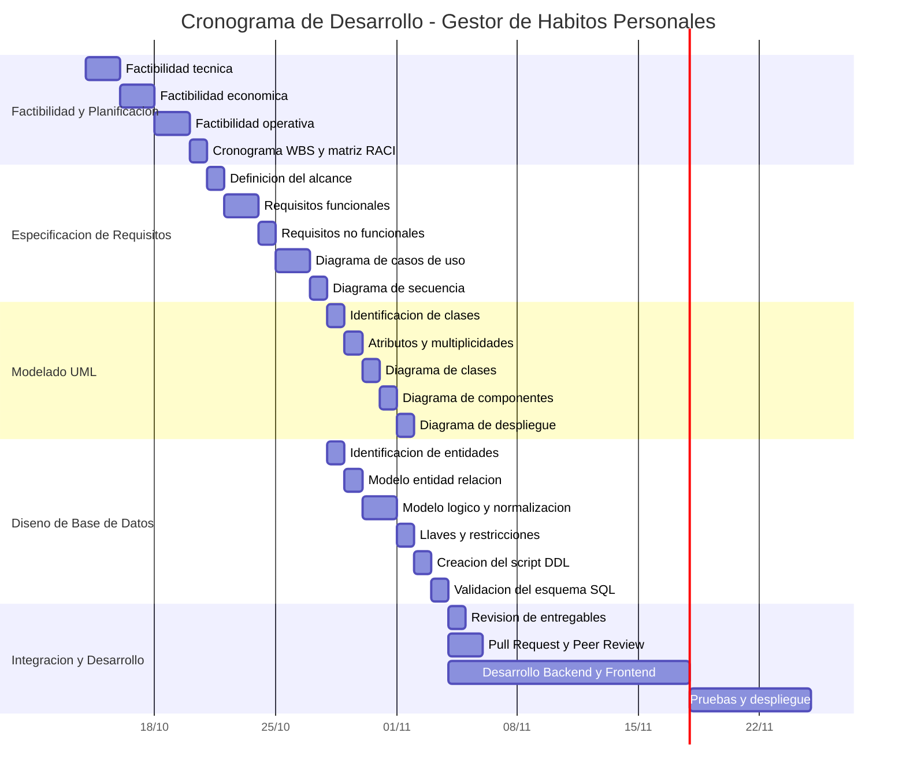

# Estudio de Factibilidad y Planificación del Proyecto

## 1. Análisis de Factibilidad Multidimensional

### 1.1 Factibilidad Técnica

El proyecto Gestor y Visualizador de Hábitos Personales consiste en el desarrollo de una aplicación web que permita registrar hábitos, consultar su cumplimiento diario, calcular rachas consecutivas, organizar actividades por categorías y visualizar el progreso mediante gráficas.

Para su implementación se propone utilizar las siguientes tecnologías:

| Tecnología | Función |
|---|---|
| HTML | Estructura de la interfaz web. |
| CSS y Bootstrap 5 | Diseño visual y adaptable de la interfaz. |
| JavaScript | Interactividad y actualización de elementos de la página. |
| PHP | Desarrollo del backend y procesamiento de solicitudes. |
| Microsoft SQL Server | Almacenamiento y administración de los datos. |
| SQLSRV | Conexión entre PHP y Microsoft SQL Server. |
| Chart.js | Generación de gráficas para visualizar el progreso. |
| Visual Studio Code | Desarrollo y edición del código fuente. |
| Git y GitHub | Control de versiones y colaboración. |

### 1.2 Factibilidad Económica

La factibilidad económica permite determinar los recursos financieros necesarios para desarrollar el sistema y evaluar si el proyecto puede realizarse con los medios disponibles.

Se propone utilizar herramientas gratuitas y un entorno de desarrollo local para reducir los costos de infraestructura.

| Recurso | Costo estimado |
|---|---:|
| Visual Studio Code | $0 MXN |
| PHP, HTML, CSS y JavaScript | $0 MXN |
| Bootstrap y Chart.js | $0 MXN |
| Git y GitHub (plan gratuito) | $0 MXN |
| SQL Server (edición gratuita) | $0 MXN |
| Servidor Apache local | $0 MXN |
| Servicios de alojamiento en la nube | $0 MXN |
| Consumo de API externas | $0 MXN |
| **Total de software e infraestructura estimado** | **$0 MXN** |

La estimación considera que el equipo dispone de computadoras personales, conexión a Internet y una edición gratuita de SQL Server. No contempla servicios de alojamiento público ni gastos indirectos.

#### Estimación de horas-hombre

Para las actividades prácticas de análisis y diseño se consideran nueve horas por integrante, distribuidas entre tres participantes.

| Actividad | Horas-hombre |
|---|---:|
| Análisis de factibilidad y planificación | 6 |
| Especificación de requisitos IEEE 830 | 9 |
| Elaboración de diagramas UML | 6 |
| Diseño de base de datos | 6 |
| **Total estimado** | **27** |

Considerando un valor hipotético de $100 MXN por hora-hombre:

**Costo estimado del trabajo = 27 × $100 = $2,700 MXN.**

Este valor representa una estimación académica del esfuerzo del equipo y no un gasto monetario real.

Se concluye que el proyecto es económicamente viable para su desarrollo local, ya que puede realizarse mediante herramientas gratuitas y recursos disponibles.

### 1.3 Factibilidad Operativa

La factibilidad operativa permite determinar si el sistema puede ser utilizado adecuadamente por sus usuarios y si las funcionalidades propuestas responden a sus necesidades.

El Gestor y Visualizador de Hábitos Personales está dirigido a usuarios que desean organizar sus actividades, registrar su cumplimiento y consultar su progreso.

La aplicación permitirá realizar las siguientes operaciones:

- Registrar hábitos personales.
- Registrar el cumplimiento diario de cada hábito.
- Consultar rachas de días consecutivos.
- Organizar los hábitos mediante categorías.
- Personalizar los hábitos con colores y etiquetas.
- Visualizar estadísticas de progreso mediante gráficas.

Para facilitar la aceptación del sistema, se diseñará una interfaz intuitiva, con formularios sencillos, botones identificables y mensajes claros.

La información ingresada será validada antes de almacenarse. Asimismo, se considerará la protección de datos personales conforme a la legislación mexicana aplicable, incluida la LFPDPPP cuando corresponda.

Los principales riesgos operativos incluyen errores en el registro de información, dificultades de navegación y resistencia a utilizar una nueva herramienta de seguimiento.

Como medidas preventivas se realizarán pruebas funcionales, revisiones de usabilidad y validaciones de los criterios de aceptación establecidos en las historias de usuario.

Se considera que el proyecto es operativamente viable, aunque su aceptación definitiva deberá comprobarse mediante pruebas con usuarios.

---

## 2. Cronograma de Trabajo y Diagrama de Gantt

El desarrollo del proyecto se organizará mediante un modelo incremental, complementado con prácticas de Scrum, XP y Kanban.

Las actividades se distribuirán de acuerdo con los procesos de análisis, especificación de requisitos, modelado UML, diseño de base de datos, implementación y pruebas.

El siguiente cronograma establece la planificación de las actividades del proyecto, tomando como referencia las fechas de la práctica integrada.

---

## 3. Matriz de Asignación de Responsabilidades (RACI)

La matriz RACI permite establecer la participación de cada integrante en las actividades de análisis y diseño.

- **R (Responsible):** Realiza la actividad.
- **A (Accountable):** Aprueba y asume la responsabilidad final del entregable.
- **C (Consulted):** Proporciona orientación o información.
- **I (Informed):** Recibe información sobre los avances.

| Tarea / Entregable | Integrante 1 | Integrante 2 | Integrante 3 |
|---|:---:|:---:|:---:|
| Estudio de factibilidad | R | A | C |
| Cronograma Gantt y WBS | A | R | I |
| Especificación SRS IEEE 830 | R | C | A |
| Requisitos funcionales y no funcionales | A | R | C |
| Diagrama de casos de uso | R | A | C |
| Diagrama de secuencia | C | R | A |
| Diagrama de clases | A | C | R |
| Diagrama de componentes | R | A | C |
| Diagrama de despliegue | C | R | A |
| Diseño conceptual de la base de datos | A | R | C |
| Diseño lógico y restricciones | C | A | R |
| Elaboración del script DDL | R | C | A |
| Validación de entregables | A | R | C |
| Pull Request y Peer Review | C | A | R |

La distribución de responsabilidades es una propuesta de planificación que deberá ser acordada por los integrantes del equipo.