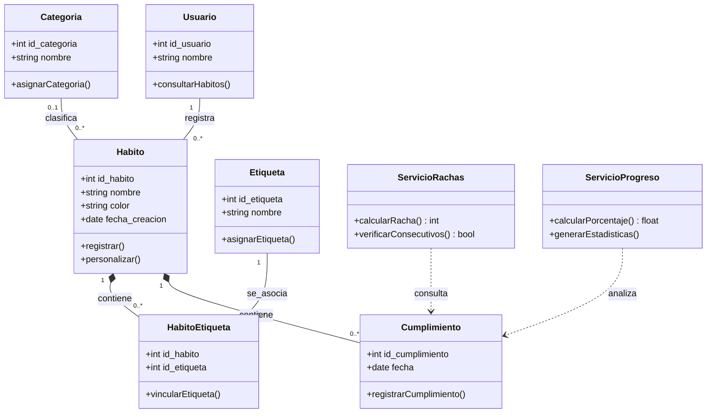
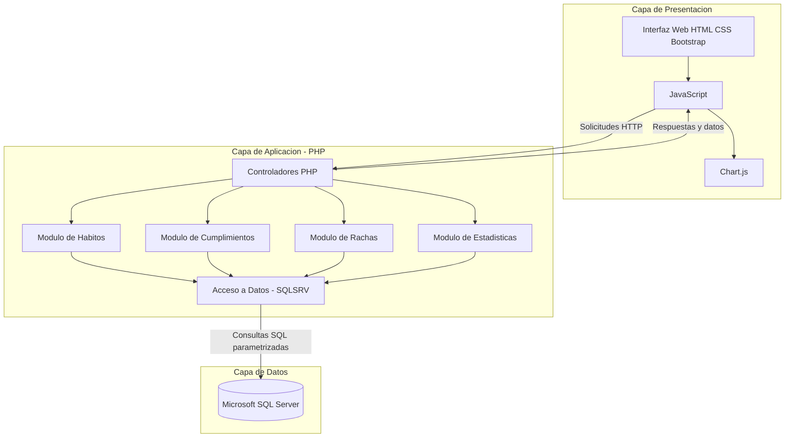
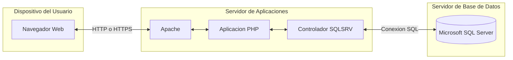

# Modelado Estructural y Diagramas de Arquitectura UML

## 1. Diagrama de Clases UML (Sintaxis Mermaid)

El diagrama de clases representa la estructura del Gestor y Visualizador de Hábitos Personales mediante las entidades, atributos, métodos y relaciones necesarias para desarrollar las funcionalidades del sistema.

Las clases principales permiten representar los usuarios, hábitos, categorías, registros de cumplimiento y etiquetas. También se consideran los servicios responsables del cálculo de rachas y de la generación de estadísticas.

### 1.1 Descripción de las clases

| Clase | Descripción |
|---|---|
| Usuario | Representa al propietario de los hábitos registrados en el sistema. |
| Habito | Almacena la información principal de cada actividad personal. |
| Categoria | Permite clasificar los hábitos de acuerdo con el tipo de actividad. |
| Cumplimiento | Almacena las fechas en las que se realiza un hábito. |
| Etiqueta | Permite identificar y personalizar los hábitos. |
| HabitoEtiqueta | Establece la relación entre los hábitos y sus etiquetas. |
| ServicioRachas | Calcula los días consecutivos de cumplimiento de un hábito. |
| ServicioProgreso | Procesa los registros para obtener estadísticas de progreso. |

### 1.2 Relaciones y multiplicidades

| Relación | Multiplicidad | Descripción |
|---|---|---|
| Usuario - Habito | 1 a 0..* | Un usuario puede tener varios hábitos registrados. |
| Categoria - Habito | 0..1 a 0..* | Un hábito puede pertenecer a una categoría y una categoría puede clasificar varios hábitos. |
| Habito - Cumplimiento | 1 a 0..* | Un hábito puede contener varios registros de cumplimiento. |
| Habito - HabitoEtiqueta | 1 a 0..* | Un hábito puede contar con varias asociaciones de etiquetas. |
| Etiqueta - HabitoEtiqueta | 1 a 0..* | Una etiqueta puede utilizarse en distintos hábitos. |

Las relaciones de composición indican que los registros de cumplimiento y las asociaciones de etiquetas dependen del hábito al que pertenecen.

Las dependencias de los servicios representan la utilización de los registros de cumplimiento para calcular rachas y generar estadísticas.

---

## 2. Diagrama de Componentes y Despliegue (Mermaid)

La arquitectura propuesta utiliza tres capas principales: presentación, lógica de negocio y datos.

La aplicación web se desarrollará utilizando HTML, CSS, Bootstrap y JavaScript para la interfaz; PHP para procesar las solicitudes; y Microsoft SQL Server para almacenar la información.

### 2.1 Diagrama de Componentes

### 2.2 Descripción de los Componentes

| Componente | Función |
|---|---|
| Interfaz Web | Presenta los formularios, botones y opciones para gestionar hábitos. |
| JavaScript | Gestiona las interacciones y solicitudes al backend. |
| Chart.js | Representa el progreso mediante gráficas. |
| Controladores PHP | Reciben solicitudes y coordinan las operaciones del sistema. |
| Módulo de Hábitos | Procesa el registro, consulta y organización de hábitos. |
| Módulo de Cumplimientos | Gestiona los registros de cumplimiento diario. |
| Módulo de Rachas | Calcula los días consecutivos de cumplimiento. |
| Módulo de Estadísticas | Procesa los datos necesarios para visualizar el progreso. |
| SQLSRV | Permite la comunicación entre PHP y Microsoft SQL Server. |
| Microsoft SQL Server | Almacena y administra los registros del sistema. |

### 2.3 Diagrama de Despliegue

El diagrama de despliegue representa la distribución de los componentes de software en la infraestructura propuesta.

La aplicación funcionará inicialmente en un entorno local mediante un navegador web, un servidor Apache con PHP y Microsoft SQL Server.

### 2.4 Descripción del Despliegue

| Elemento | Descripción |
|---|---|
| Dispositivo del usuario | Equipo desde el cual se accede a la aplicación mediante un navegador. |
| Navegador web | Ejecuta la interfaz HTML, CSS y JavaScript. |
| Apache | Recibe y atiende las solicitudes HTTP de la aplicación. |
| PHP | Ejecuta la lógica de negocio y procesa la información. |
| SQLSRV | Establece la comunicación entre PHP y SQL Server. |
| Microsoft SQL Server | Administra la persistencia de hábitos, categorías, etiquetas y cumplimientos. |

La separación de las capas de presentación, aplicación y datos facilita el mantenimiento del sistema, permite organizar sus funcionalidades y favorece la incorporación progresiva de nuevas características.