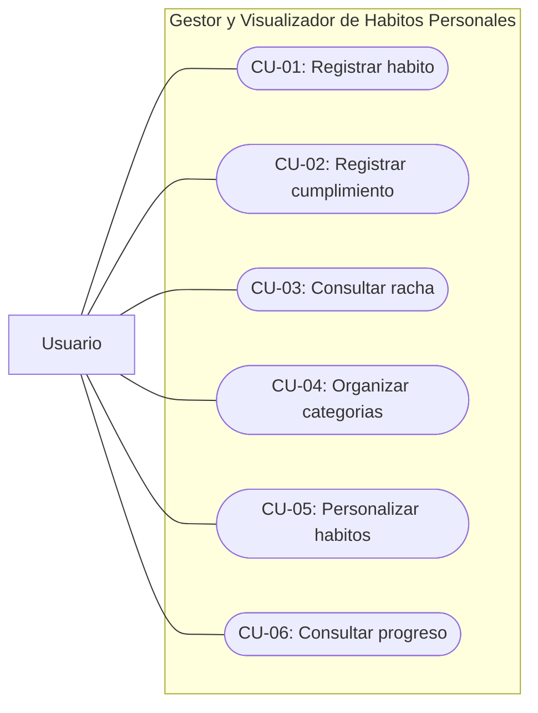
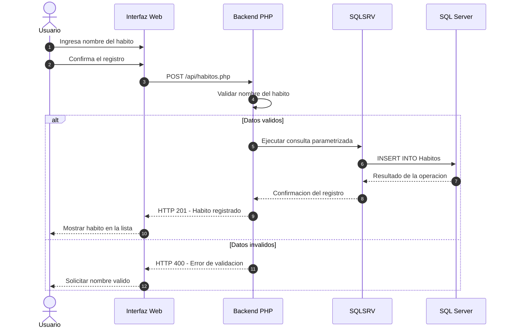
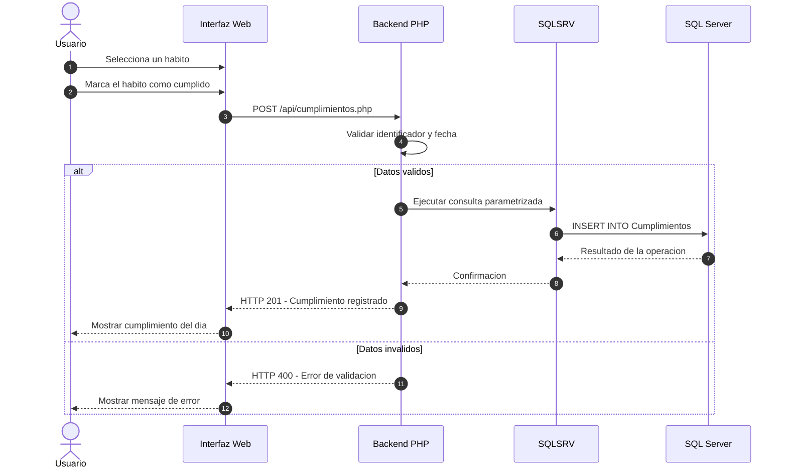

# Especificación de Requisitos de Software (SRS) - IEEE Std 830-1998

## 1. Introducción y Propósito

El presente documento establece los requisitos funcionales y no funcionales del sistema Gestor y Visualizador de Hábitos Personales, con el propósito de definir las características, funcionalidades y restricciones que deberán considerarse durante su desarrollo.

La especificación se fundamenta en las historias de usuario previamente establecidas y servirá como referencia para el diseño, implementación y validación del sistema.

### 1.1 Alcance del Sistema

El Gestor y Visualizador de Hábitos Personales será una aplicación web orientada al registro, organización y seguimiento de actividades personales.

El sistema permitirá registrar hábitos, marcar su cumplimiento diario, calcular rachas de días consecutivos, organizar las actividades por categorías y consultar gráficas relacionadas con el progreso.

También se contempla la personalización mediante colores y etiquetas.

Para su implementación se propone utilizar HTML, CSS, Bootstrap y JavaScript en la interfaz web, PHP para el procesamiento de solicitudes y Microsoft SQL Server para el almacenamiento de información.

La comunicación entre PHP y SQL Server se realizará mediante el controlador SQLSRV.

Las funcionalidades principales estarán organizadas de acuerdo con las seis historias de usuario establecidas previamente.

La incorporación de puntos, niveles y medallas se considera una posible ampliación futura y no forma parte del alcance funcional definido en esta especificación.

---

## 2. Requerimientos Funcionales (RF)

Los requerimientos funcionales describen las operaciones que el sistema deberá proporcionar a los usuarios.

| Código | Nombre del Requisito | Descripción | Prioridad | Actor Principal |
|---|---|---|---|---|
| RF-01 | Registrar hábitos | El sistema permitirá registrar un hábito mediante un nombre válido y almacenarlo en la base de datos. | Alta | Usuario |
| RF-02 | Registrar cumplimiento diario | El sistema permitirá marcar un hábito como cumplido y almacenar la fecha correspondiente. | Alta | Usuario |
| RF-03 | Calcular rachas consecutivas | El sistema calculará los días consecutivos de cumplimiento a partir de los registros almacenados. | Alta | Usuario |
| RF-04 | Organizar hábitos por categorías | El sistema permitirá asociar los hábitos con categorías y distinguirlos mediante dicha clasificación. | Media | Usuario |
| RF-05 | Personalizar hábitos | El sistema permitirá asignar colores y etiquetas a los hábitos registrados. | Media | Usuario |
| RF-06 | Visualizar progreso | El sistema permitirá consultar gráficas que representen el cumplimiento y progreso de los hábitos. | Alta | Usuario |

### 2.1 Condiciones de Verificación

| Requisito | Condición de Verificación |
|---|---|
| RF-01 | Al ingresar un nombre válido, el hábito deberá almacenarse y mostrarse en la lista. Si el campo está vacío, deberá solicitarse que se complete. |
| RF-02 | Al marcar un hábito como cumplido, deberá registrarse la fecha y mostrarse el cumplimiento correspondiente. |
| RF-03 | El sistema deberá calcular correctamente las rachas consecutivas y actualizar el resultado cuando exista una interrupción. |
| RF-04 | Al seleccionar una categoría, el hábito deberá asociarse con ella y mostrarse mediante su clasificación. |
| RF-05 | Los colores y etiquetas seleccionados deberán conservarse y visualizarse en el hábito correspondiente. |
| RF-06 | Cuando existan registros, deberá generarse una gráfica de progreso. Si no existen datos suficientes, deberá mostrarse un mensaje informativo. |

---

## 3. Requerimientos No Funcionales (RNF - ISO/IEC 25010)

Los requerimientos no funcionales establecen las condiciones de calidad relacionadas con el rendimiento, seguridad y mantenibilidad del sistema.

### RNF-01: Rendimiento

El sistema deberá responder a las operaciones habituales de consulta y registro en un tiempo máximo objetivo de 2 segundos bajo condiciones de prueba definidas.

Las consultas a SQL Server deberán recuperar únicamente la información necesaria, evitando operaciones redundantes durante el cálculo de rachas y la generación de estadísticas.

**Verificación:** Medir los tiempos de respuesta durante las pruebas funcionales y de rendimiento.

### RNF-02: Seguridad

El sistema deberá validar los datos ingresados antes de procesarlos y utilizar consultas SQL parametrizadas para reducir el riesgo de inyección SQL.

Las credenciales de conexión con la base de datos deberán mantenerse fuera del código fuente compartido en GitHub.

Cuando la aplicación se publique en un servidor accesible por Internet, deberá utilizar una conexión HTTPS para proteger la información transmitida.

**Verificación:** Comprobar la validación de entradas, las consultas parametrizadas y la configuración segura de las credenciales.

### RNF-03: Mantenibilidad

El sistema deberá organizarse mediante una separación entre interfaz web, lógica de negocio y acceso a los datos.

Las funciones y variables deberán utilizar nombres descriptivos y el código deberá contar con documentación suficiente para facilitar su modificación.

Se establece como objetivo alcanzar una cobertura mínima del 80% de pruebas unitarias sobre la lógica de negocio implementada.

**Verificación:** Revisar la organización del código, su documentación y los resultados de las pruebas unitarias.

---

## 4. Diagrama de Casos de Uso (Mermaid) y Descripción Tabular

### 4.1 Diagrama de Casos de Uso

### 4.2 Descripción de Casos de Uso

| Elemento | Descripción |
|---|---|
| Identificador | CU-01 |
| Nombre | Registrar hábito |
| Actor | Usuario |
| Precondición | El usuario accede al formulario de registro. |
| Flujo principal | El usuario ingresa el nombre del hábito, confirma el registro y el sistema almacena la información. |
| Flujo alternativo | Si el nombre está vacío, el sistema solicita completar el campo. |
| Postcondición | El hábito queda registrado y aparece en la lista. |
| Requisito asociado | RF-01 |

| Elemento | Descripción |
|---|---|
| Identificador | CU-02 |
| Nombre | Registrar cumplimiento diario |
| Actor | Usuario |
| Precondición | Existe un hábito previamente registrado. |
| Flujo principal | El usuario selecciona el hábito y lo marca como cumplido. El sistema almacena la fecha correspondiente. |
| Flujo alternativo | Si ocurre un error durante el registro, se muestra un mensaje y no se confirma la operación. |
| Postcondición | El cumplimiento queda almacenado y puede consultarse. |
| Requisito asociado | RF-02 |

| Elemento | Descripción |
|---|---|
| Identificador | CU-03 |
| Nombre | Consultar racha consecutiva |
| Actor | Usuario |
| Precondición | Existe un hábito registrado. |
| Flujo principal | El usuario consulta el hábito y el sistema procesa las fechas de cumplimiento para calcular la racha. |
| Flujo alternativo | Si existe una interrupción, el sistema actualiza el cálculo según los registros disponibles. |
| Postcondición | Se muestra la cantidad de días consecutivos cumplidos. |
| Requisito asociado | RF-03 |

| Elemento | Descripción |
|---|---|
| Identificador | CU-04 |
| Nombre | Organizar hábitos por categorías |
| Actor | Usuario |
| Precondición | El usuario accede al registro o consulta de hábitos. |
| Flujo principal | El usuario selecciona una categoría y el sistema la asocia con el hábito correspondiente. |
| Flujo alternativo | Si no se selecciona una categoría, el sistema conserva el hábito sin clasificación específica. |
| Postcondición | El hábito puede identificarse mediante su categoría. |
| Requisito asociado | RF-04 |

| Elemento | Descripción |
|---|---|
| Identificador | CU-05 |
| Nombre | Personalizar hábitos |
| Actor | Usuario |
| Precondición | Existe un hábito registrado. |
| Flujo principal | El usuario selecciona un color o agrega una etiqueta y confirma los cambios. |
| Flujo alternativo | Si no se realizan modificaciones, se conserva la configuración anterior. |
| Postcondición | El hábito muestra su color o etiqueta correspondiente. |
| Requisito asociado | RF-05 |

| Elemento | Descripción |
|---|---|
| Identificador | CU-06 |
| Nombre | Consultar progreso |
| Actor | Usuario |
| Precondición | El usuario accede a la sección de progreso. |
| Flujo principal | El sistema consulta los registros almacenados, procesa las estadísticas y genera las gráficas correspondientes. |
| Flujo alternativo | Si no existen registros suficientes, se muestra un mensaje informativo. |
| Postcondición | El usuario visualiza su progreso o recibe una indicación sobre la ausencia de datos. |
| Requisito asociado | RF-06 |

---

## 5. Diagramas de Secuencia UML (Mermaid)

### 5.1 Secuencia: Registro de un Hábito

### 5.2 Secuencia: Registro de Cumplimiento Diario

