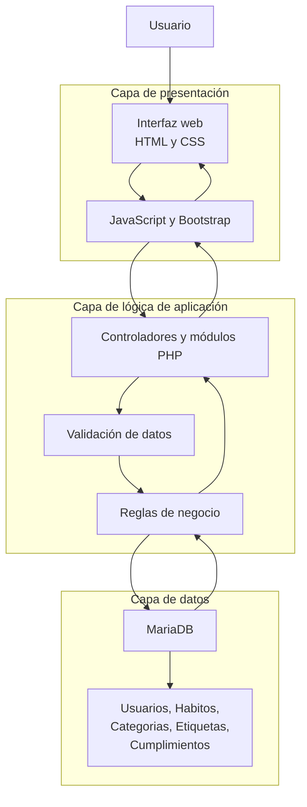

# Arquitectura y Diseño del Sistema

**Proyecto:** Gestor y Visualizador de Hábitos Personales  
**Asignatura:** Ingeniería de Software  
**Unidad:** 2 - Análisis y Diseño  
**Equipo:** Equipo A, Grupo 7A  
**Integrantes:** Isela Carranco Martínez, Carla Guadalupe Ruiz Vallejo y Manuel Arreguín Tamayo  
**Institución:** Universidad Politécnica de Guanajuato  

---

## 1. Introducción

El Gestor y Visualizador de Hábitos Personales es una aplicación web propuesta para facilitar el registro, organización y seguimiento de actividades que los usuarios desean incorporar a su rutina. El sistema permitirá registrar hábitos, guardar su cumplimiento diario, calcular rachas consecutivas, clasificarlos por categorías y consultar el progreso mediante gráficas.

Este documento describe la arquitectura lógica del sistema, la distribución de sus componentes, las tecnologías consideradas, el diseño general de las interfaces y los contratos de comunicación entre la interfaz y la lógica de aplicación.

El proyecto se encuentra en la etapa de análisis y diseño. Por lo tanto, los elementos descritos representan la propuesta técnica que servirá como base para la implementación.

## 2. Tecnologías consideradas

| Elemento | Tecnología | Función |
|---|---|---|
| Interfaz | HTML | Estructurar las pantallas de la aplicación. |
| Estilos | CSS y Bootstrap | Dar formato y adaptar las pantallas a diferentes tamaños. |
| Interactividad | JavaScript | Validaciones en el navegador y actualización de elementos de la interfaz. |
| Lógica del servidor | PHP | Procesar solicitudes y aplicar las reglas del sistema. |
| Base de datos | MariaDB | Almacenar usuarios, hábitos, categorías y cumplimientos. |
| Entorno local | XAMPP | Proporcionar el servidor web y el servicio de base de datos para el desarrollo local. |
| Administración de datos | phpMyAdmin | Consultar y administrar la base de datos durante el desarrollo. |
| Control de versiones | Git y GitHub | Registrar cambios y facilitar la colaboración del equipo. |

La conexión entre PHP y MariaDB deberá configurarse durante la implementación. El mecanismo específico de conexión se definirá de acuerdo con la decisión técnica del equipo.

## 3. Patrón arquitectónico seleccionado

### 3.1 Arquitectura en tres capas

Se propone una arquitectura en tres capas porque permite separar la presentación de la lógica de aplicación y del almacenamiento de datos. Esta organización facilita modificar una parte del sistema sin tener que modificar directamente las demás.

**Capa de presentación**

Está formada por las páginas HTML, los estilos CSS, Bootstrap y JavaScript. Su responsabilidad es mostrar la información, recibir los datos del usuario y presentar los resultados de las operaciones.

**Capa de lógica de aplicación**

Está formada por los archivos y módulos PHP encargados de recibir las solicitudes, validar los datos y ejecutar las reglas del sistema. Entre sus responsabilidades se encuentran registrar hábitos, guardar cumplimientos, calcular rachas y preparar las estadísticas.

**Capa de datos**

Está formada por MariaDB y las operaciones de acceso a la base de datos. Su responsabilidad es almacenar y recuperar la información de usuarios, hábitos, categorías, etiquetas y cumplimientos.

### 3.2 Justificación de la elección

La arquitectura en tres capas se adapta a las características del proyecto porque sus funciones pueden separarse en responsabilidades específicas. La interfaz no necesita contener las reglas para calcular las rachas ni las instrucciones para consultar directamente las tablas.

PHP se encargará de procesar las operaciones solicitadas y comunicarse con MariaDB. De esta manera, si posteriormente se modifica el diseño de las pantallas, las reglas de cálculo y la estructura de almacenamiento podrán conservarse sin depender directamente de esos cambios.

También facilita la revisión y el mantenimiento del proyecto, ya que cada capa tiene una responsabilidad definida.

## 4. Organización de componentes

La siguiente propuesta representa la comunicación general entre las capas:



El usuario interactúa con la interfaz web. JavaScript puede enviar los datos al servidor mediante solicitudes HTTP. PHP valida la información, ejecuta la operación correspondiente y consulta o modifica los datos almacenados en MariaDB. Finalmente, el resultado se devuelve a la interfaz para mostrarse al usuario.

## 5. Diseño de interfaces de usuario (UI/UX)

Las interfaces se diseñarán procurando que las operaciones principales sean fáciles de localizar y utilizar. Se propone una distribución sencilla, con navegación clara y formularios con campos identificables.

### 5.1 Pantalla principal o panel de control

**Objetivo:** mostrar un resumen de los hábitos del usuario y facilitar el acceso a las funciones principales.

Elementos propuestos:

- Menú de navegación.
- Resumen de hábitos registrados.
- Lista de hábitos activos.
- Estado de cumplimiento del día.
- Información de rachas consecutivas.
- Acceso a las estadísticas de progreso.

Wireframe de referencia:

```text
+--------------------------------------------------+
| GESTOR DE HABITOS             Usuario             |
+--------------------------------------------------+
| Inicio | Mis habitos | Categorias | Estadisticas |
+--------------------------------------------------+
|                                                  |
| Bienvenido                                       |
|                                                  |
| Habitos registrados: [Total]                    |
| Cumplidos hoy:        [Total]                    |
|                                                  |
| MIS HABITOS                                      |
| +----------------------------------------------+ |
| | Leer                 [Marcar cumplimiento]   | |
| | Hacer ejercicio      [Marcar cumplimiento]   | |
| | Estudiar             [Marcar cumplimiento]   | |
| +----------------------------------------------+ |
|                                                  |
| Racha actual: [Cantidad de dias]                 |
|                                                  |
+--------------------------------------------------+
```

### 5.2 Pantalla de registro de hábitos

**Objetivo:** permitir que el usuario agregue un nuevo hábito.

Elementos propuestos:

- Campo para el nombre del hábito.
- Campo para la descripción.
- Selector de categoría.
- Configuración de frecuencia, de acuerdo con las opciones definidas para el sistema.
- Botón para guardar.
- Opción para cancelar.

Wireframe de referencia:

```text
+------------------------------------------+
| REGISTRAR NUEVO HABITO                   |
+------------------------------------------+
| Nombre:                                  |
| [____________________________________]   |
|                                          |
| Descripcion:                             |
| [____________________________________]   |
| [____________________________________]   |
|                                          |
| Categoria:                               |
| [Seleccionar categoria              v]   |
|                                          |
| Frecuencia:                              |
| [Seleccionar frecuencia             v]   |
|                                          |
| [Guardar]                 [Cancelar]     |
+------------------------------------------+
```

### 5.3 Pantalla de estadísticas

**Objetivo:** permitir que el usuario consulte el avance de sus hábitos.

Elementos propuestos:

- Selector de periodo.
- Resumen de cumplimientos.
- Gráfica de progreso.
- Información de rachas.
- Comparación de registros por periodo, cuando corresponda.

Wireframe de referencia:

```text
+------------------------------------------+
| ESTADISTICAS Y PROGRESO                  |
+------------------------------------------+
| Periodo: [Ultimos 7 dias             v]  |
|                                          |
| Cumplimientos registrados: [Total]      |
|                                          |
| PROGRESO                                 |
| +--------------------------------------+ |
| |                                      | |
| |          [Grafica de avance]         | |
| |                                      | |
| +--------------------------------------+ |
|                                          |
| Racha actual: [Cantidad de dias]         |
|                                          |
+------------------------------------------+
```

Los wireframes representan una distribución inicial de los elementos. Los colores, tipografías, iconos y dimensiones definitivas se establecerán durante el desarrollo de la interfaz.

## 6. Contratos de API y operaciones HTTP

Se propone organizar las operaciones del sistema mediante rutas HTTP. PHP recibirá las solicitudes, validará los datos y devolverá respuestas estructuradas en formato JSON cuando se utilice comunicación asíncrona desde JavaScript.

Los siguientes endpoints son una propuesta de diseño; deberán coincidir con las rutas que se implementen posteriormente.

| Método | Endpoint propuesto | Descripción | Requisito relacionado |
|---|---|---|---|
| GET | `/api/habitos.php` | Consultar los hábitos registrados. | RF-01 |
| POST | `/api/habitos.php` | Registrar un nuevo hábito. | RF-01 |
| PUT | `/api/habitos.php?id={id}` | Modificar la información de un hábito. | RF-01 |
| DELETE | `/api/habitos.php?id={id}` | Eliminar un hábito. | RF-01 |
| POST | `/api/cumplimientos.php` | Registrar el cumplimiento de un hábito en una fecha. | RF-02 |
| GET | `/api/cumplimientos.php?habito_id={id}` | Consultar los cumplimientos de un hábito. | RF-02 |
| GET | `/api/rachas.php?habito_id={id}` | Consultar la racha de un hábito. | RF-03 |
| GET | `/api/categorias.php` | Consultar las categorías disponibles. | RF-04 |
| POST | `/api/categorias.php` | Registrar una categoría. | RF-04 |
| POST | `/api/etiquetas.php` | Registrar una etiqueta o asociación con un hábito. | RF-05 |
| GET | `/api/estadisticas.php?habito_id={id}` | Consultar los datos necesarios para las gráficas. | RF-06 |

### 6.1 Descripción de los métodos HTTP

- **GET:** obtiene información sin modificar los registros.
- **POST:** registra información nueva.
- **PUT:** actualiza información existente.
- **DELETE:** elimina un recurso identificado.

### 6.2 Estructura general de respuesta

Ejemplo de respuesta satisfactoria:

```json
{
  "success": true,
  "message": "El habito se registro correctamente",
  "data": {
    "id": 1,
    "nombre": "Leer"
  }
}
```

Ejemplo de respuesta con error:

```json
{
  "success": false,
  "message": "El nombre del habito es obligatorio",
  "data": null
}
```

Las respuestas son ejemplos de formato y no representan resultados de una API que ya se encuentre implementada.

## 7. Relación entre la arquitectura y la base de datos

La capa de datos utilizará MariaDB para conservar la información del sistema. El modelo contempla las siguientes entidades principales:

| Tabla | Responsabilidad |
|---|---|
| `Usuarios` | Almacenar los datos de los usuarios. |
| `Categorias` | Registrar las categorías utilizadas para organizar los hábitos. |
| `Etiquetas` | Almacenar las etiquetas disponibles para clasificar los hábitos. |
| `Habitos` | Guardar la información de los hábitos registrados. |
| `Cumplimientos` | Registrar el cumplimiento de los hábitos por fecha. |
| `HabitoEtiquetas` | Relacionar los hábitos con sus etiquetas. |

Las relaciones, llaves primarias, llaves foráneas y restricciones se especifican en el modelo de base de datos y en el archivo `database/schema.sql`.

## 8. Consideraciones de seguridad y calidad

Para proteger la información y reducir errores durante el procesamiento, se consideran las siguientes medidas:

- Validar los datos recibidos antes de almacenarlos.
- Utilizar consultas parametrizadas para evitar inyección SQL.
- No publicar contraseñas ni credenciales de conexión en GitHub.
- Mantener separadas las responsabilidades de presentación, lógica y datos.
- Verificar que un cumplimiento no se registre de manera duplicada para el mismo hábito y fecha, de acuerdo con las reglas del sistema.
- Mostrar mensajes comprensibles cuando una operación falle.
- Comprobar el comportamiento de las operaciones mediante pruebas.

Estas medidas son criterios de diseño que deberán verificarse durante la implementación y las pruebas.

## 9. Conclusión

La arquitectura en tres capas permite organizar el Gestor y Visualizador de Hábitos Personales mediante responsabilidades separadas para la interfaz, la lógica de aplicación y la persistencia de datos. La propuesta utiliza tecnologías compatibles con el entorno local de desarrollo, como PHP, MariaDB y XAMPP.

La definición de los componentes, las interfaces y los contratos de comunicación proporciona una referencia para la futura implementación y permite relacionar las operaciones del sistema con los requisitos funcionales establecidos.