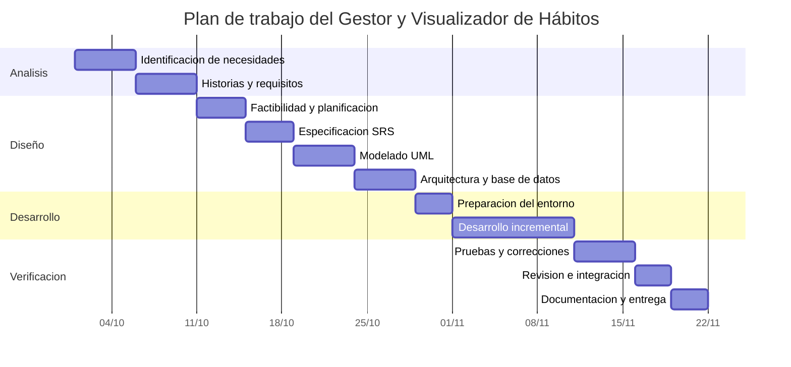
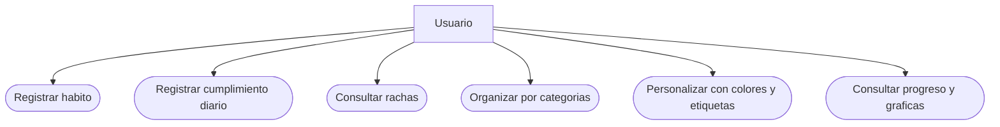
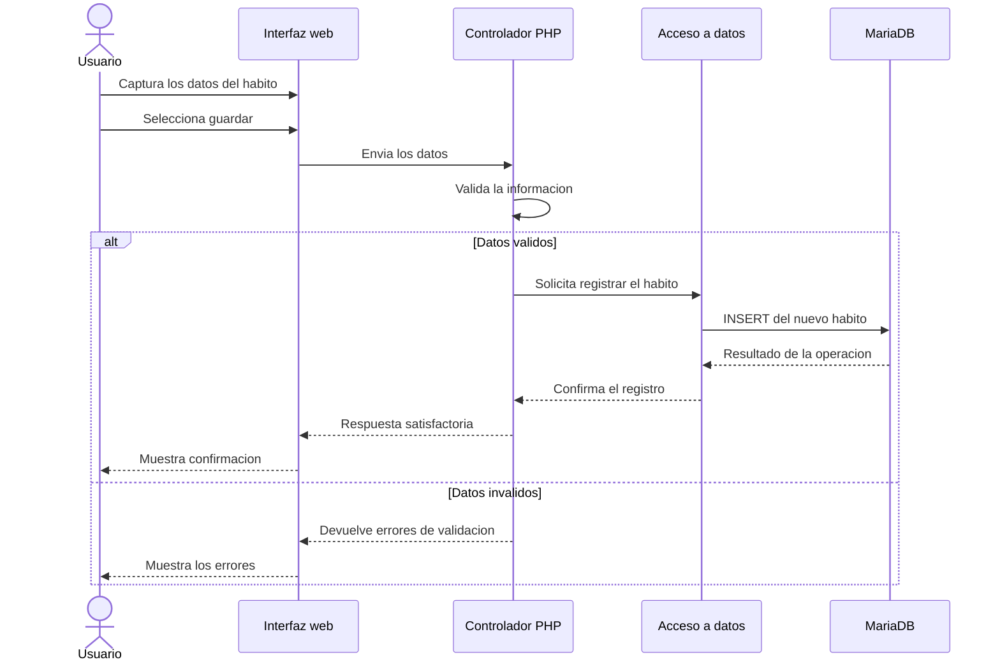
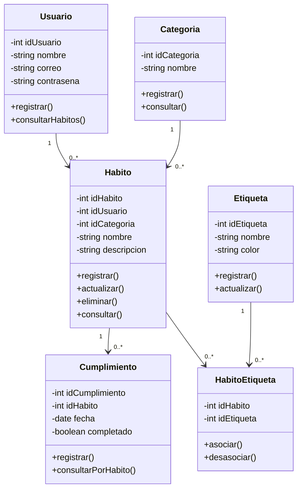
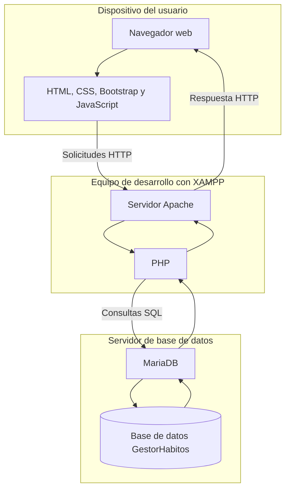
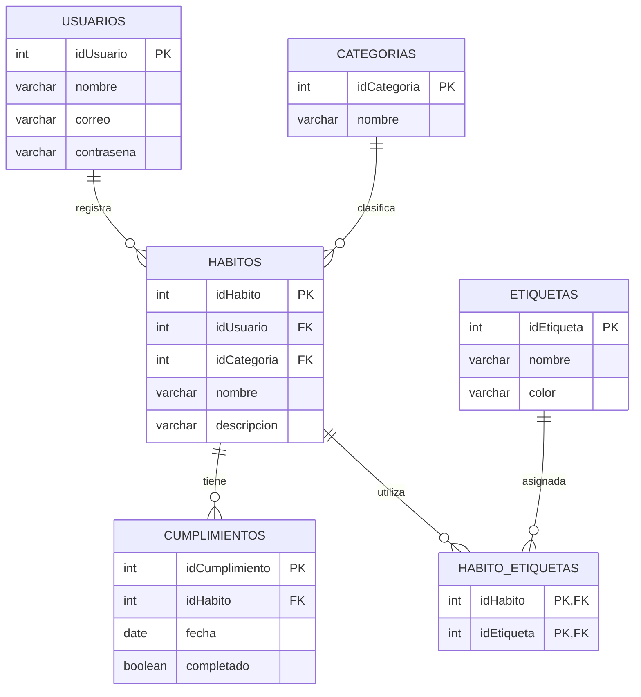

# Portafolio de Análisis y Diseño

**Proyecto:** Gestor y Visualizador de Hábitos Personales  
**Asignatura:** Ingeniería de Software  
**Unidad:** 2 - Análisis y Diseño  
**Equipo:** Equipo A, Grupo 7A  
**Integrantes:**
- Isela Carranco Martínez
- Carla Guadalupe Ruiz Vallejo
- Manuel Arreguín Tamayo

**Institución:** Universidad Politécnica de Guanajuato  
**Versión del documento:** 2.0-u2

---

## Introducción

El presente portafolio integra los artefactos de análisis y diseño del proyecto Gestor y Visualizador de Hábitos Personales. Su propósito es reunir la factibilidad, la especificación de requisitos, los modelos UML, el diseño de la base de datos y la arquitectura propuesta para el sistema.

El proyecto busca facilitar el seguimiento de hábitos personales mediante una aplicación web que permita registrar actividades, guardar sus cumplimientos diarios, calcular rachas consecutivas, organizar los hábitos por categorías y consultar el progreso mediante gráficas.

La integración de estos elementos permite mantener una relación entre las necesidades identificadas, las funcionalidades propuestas, la estructura del sistema y el almacenamiento de la información.

El proyecto se encuentra en la etapa de análisis y diseño. Los diagramas, interfaces y contratos incluidos representan la propuesta que servirá como referencia para la implementación.

## 1. Factibilidad y planificación

### 1.1 Descripción del proyecto

El sistema busca resolver las dificultades que presentan las personas al intentar organizar sus actividades mediante anotaciones en papel o notas digitales dispersas. Estos métodos pueden dificultar el seguimiento de las actividades, favorecer los olvidos y limitar la consulta del progreso.

La aplicación centralizará la información de los hábitos y permitirá consultar su cumplimiento a lo largo del tiempo.

### 1.2 Estudio de factibilidad técnica

El proyecto es técnicamente viable porque utiliza herramientas y tecnologías disponibles para el equipo y adecuadas para el desarrollo de una aplicación web.

| Recurso | Uso en el proyecto |
|---|---|
| Visual Studio Code | Edición de archivos y desarrollo. |
| HTML y CSS | Estructura y presentación de las interfaces. |
| Bootstrap | Diseño adaptable de las pantallas. |
| JavaScript | Interactividad del lado del cliente. |
| PHP | Procesamiento de solicitudes y reglas de aplicación. |
| MariaDB | Almacenamiento de la información. |
| XAMPP | Entorno local para ejecutar el servidor y la base de datos. |
| phpMyAdmin | Administración de la base de datos. |
| Git y GitHub | Control de versiones y colaboración. |

El equipo cuenta con herramientas para desarrollar y probar el sistema en un entorno local. La complejidad técnica se considera moderada debido al registro de información, el cálculo de rachas, las relaciones entre entidades y la generación de estadísticas.

### 1.3 Estudio de factibilidad económica

Se considera viable económicamente porque las herramientas seleccionadas cuentan con versiones gratuitas o de código abierto que permiten desarrollar el proyecto sin adquirir licencias comerciales.

| Recurso | Costo considerado |
|---|---|
| Visual Studio Code | Sin costo de licencia. |
| PHP | Sin costo de licencia. |
| MariaDB | Sin costo de licencia. |
| XAMPP | Sin costo de licencia. |
| phpMyAdmin | Sin costo de licencia. |
| Git y GitHub | Se considera el uso de sus funciones gratuitas. |

El desarrollo se realizará con los equipos de cómputo disponibles para los integrantes. No se contempla inicialmente la contratación de servicios de alojamiento o infraestructura externa.

Aunque las herramientas no generan un costo de licencia, el proyecto requiere tiempo de análisis, diseño, desarrollo, pruebas y documentación por parte del equipo.

### 1.4 Estudio de factibilidad operativa

El sistema está dirigido a personas que desean organizar sus actividades y dar seguimiento a sus hábitos. Su funcionamiento se plantea mediante una interfaz web con opciones para registrar, consultar y organizar información.

La navegación se organizará mediante secciones para facilitar el acceso a los hábitos, categorías y estadísticas. Los usuarios no necesitarán conocimientos de programación para utilizar las funciones principales.

El equipo puede distribuir las actividades de análisis, diseño, implementación y revisión entre sus tres integrantes. Además, GitHub permitirá registrar los cambios y mantener la documentación del proyecto.

### 1.5 Planificación del proyecto

El desarrollo se organizará mediante un enfoque incremental, con prácticas de organización de Scrum, prácticas de calidad de XP y gestión visual mediante Kanban.

Las actividades se dividirán en etapas para facilitar la revisión de los requisitos, el diseño, la implementación y las pruebas.

#### Diagrama de Gantt WBS

El diagrama representa una secuencia general de trabajo. Las fechas son una referencia de planificación y deberán ajustarse al calendario y a los acuerdos del equipo.

#### Matriz RACI

RACI identifica quién realiza una actividad (R), quién responde por su resultado (A), quién debe ser consultado (C) y quién debe mantenerse informado (I).

| Actividad | Isela Carranco | Carla Ruiz | Manuel Arreguín |
|---|---|---|---|
| Requisitos y documentación | R/A | C | C |
| Registro de hábitos (HU-01) | R/A | C | I |
| Cumplimiento diario (HU-02) | C | R/A | I |
| Cálculo de rachas (HU-03) | I | C | R/A |
| Categorías (HU-04) | R/A | C | I |
| Revisión y pruebas | R | R | R |
| Integración y documentación final | R | R | R |

La distribución inicial toma como referencia las responsabilidades de las historias de usuario del Sprint 1. Las actividades de revisión, integración y documentación se consideran responsabilidad compartida.

---

## 2. Especificación de requisitos IEEE 830

### 2.1 Propósito

La especificación de requisitos describe las funciones y características de calidad que deberá cumplir el Gestor y Visualizador de Hábitos Personales. Sirve como referencia para el diseño, la implementación y las pruebas del sistema.

### 2.2 Requerimientos funcionales

| ID | Requerimiento funcional | Descripción |
|---|---|---|
| RF-01 | Registro de hábitos | El sistema permitirá registrar hábitos con la información solicitada en el formulario correspondiente. |
| RF-02 | Registro de cumplimiento | El sistema permitirá registrar el cumplimiento diario de los hábitos. |
| RF-03 | Cálculo de rachas | El sistema calculará los días consecutivos en los que se ha cumplido un hábito. |
| RF-04 | Organización por categorías | El sistema permitirá organizar los hábitos mediante categorías. |
| RF-05 | Personalización con colores y etiquetas | El sistema permitirá asociar colores o etiquetas para facilitar la identificación de los hábitos. |
| RF-06 | Visualización del progreso | El sistema permitirá consultar el avance de los hábitos mediante estadísticas y gráficas. |

### 2.3 Requerimientos no funcionales

Los requerimientos no funcionales describen condiciones de calidad que deberá cumplir el sistema. Se relacionan con características de calidad de ISO/IEC 25010.

| ID | Atributo de calidad | Requerimiento y criterio de evaluación |
|---|---|---|
| RNF-01 | Eficiencia de desempeño | Las operaciones principales deberán responder en un tiempo objetivo máximo de 2 segundos bajo las condiciones de prueba establecidas. |
| RNF-02 | Seguridad | El sistema deberá validar los datos recibidos, utilizar consultas parametrizadas y mantener las credenciales de conexión fuera del repositorio. |
| RNF-03 | Mantenibilidad | El sistema deberá organizarse en capas separadas, contar con documentación técnica y alcanzar una cobertura objetivo de al menos 80% en las pruebas unitarias. |
| RNF-04 | Mantenibilidad | Se procurará que las funciones tengan un máximo objetivo de 15 líneas y una complejidad ciclomática menor que 5, conforme a los criterios de calidad definidos para el proyecto. |

Los valores indicados representan objetivos que deberán comprobarse durante las pruebas. No significan que el sistema ya haya alcanzado dichos resultados.

### 2.4 Relación entre requisitos e historias de usuario

| Requerimiento | Historia de usuario relacionada |
|---|---|
| RF-01 | HU-01: Registrar un hábito. |
| RF-02 | HU-02: Registrar el cumplimiento diario. |
| RF-03 | HU-03: Calcular racha de días consecutivos. |
| RF-04 | HU-04: Organizar hábitos por categorías. |
| RF-05 | HU-05: Personalizar hábitos con colores y etiquetas. |
| RF-06 | HU-06: Visualizar el progreso mediante gráficas. |

### 2.5 Documento de referencia

La especificación detallada de requisitos se encuentra en:

[`SRS_IEEE830.md`](SRS_IEEE830.md)

---

## 3. Modelado UML

El modelado UML representa el comportamiento y la estructura propuesta del sistema. Los diagramas permiten relacionar las funciones solicitadas con los elementos que participarán en su ejecución.

### 3.1 Diagrama de casos de uso

El actor principal es el usuario, quien interactúa con el sistema para administrar sus hábitos y consultar su progreso.

### 3.2 Especificación narrativa de casos de uso

| Caso de uso | Requisito | Descripción | Resultado esperado |
|---|---|---|---|
| CU-01 Registrar hábito | RF-01 | El usuario captura la información de un nuevo hábito y solicita guardarlo. | El hábito queda registrado. |
| CU-02 Registrar cumplimiento | RF-02 | El usuario selecciona un hábito y registra si lo cumplió en una fecha. | El cumplimiento queda almacenado. |
| CU-03 Consultar rachas | RF-03 | El usuario consulta los días consecutivos de cumplimiento de un hábito. | El sistema muestra la racha calculada. |
| CU-04 Organizar categorías | RF-04 | El usuario organiza sus hábitos mediante categorías. | Los hábitos quedan asociados a sus categorías. |
| CU-05 Personalizar hábitos | RF-05 | El usuario asigna colores o etiquetas a sus hábitos. | La identificación visual queda actualizada. |
| CU-06 Consultar progreso | RF-06 | El usuario solicita consultar sus estadísticas. | El sistema presenta la información mediante gráficas. |

### 3.3 Diagrama de secuencia

El siguiente diagrama representa el proceso de registro de un hábito, relacionado con RF-01.

### 3.4 Diagrama de clases

El siguiente modelo representa las entidades principales y las operaciones propuestas. Los atributos deberán mantenerse alineados con los campos definitivos de `database/schema.sql`.

Las clases representan los datos principales del dominio. Las operaciones mostradas son responsabilidades propuestas y deberán coincidir con los métodos definidos en el modelo UML detallado y con las operaciones que se implementen en PHP.

### 3.5 Diagrama de despliegue

### 3.6 Documento de referencia

El desarrollo de los diagramas y sus especificaciones se encuentra en:

[`MODELADO_UML.md`](MODELADO_UML.md)

---

## 4. Diseño de base de datos

### 4.1 Descripción general

La base de datos se utilizará para almacenar la información necesaria para el funcionamiento del sistema. Se propone un modelo relacional administrado mediante MariaDB.

Las entidades principales corresponden a usuarios, hábitos, categorías, etiquetas y cumplimientos.

### 4.2 Modelo entidad-relación

El diagrama representa las entidades y relaciones generales. Los tipos y nombres definitivos deberán coincidir con el script DDL.

### 4.3 Esquema lógico

| Tabla | Llave primaria | Relaciones principales |
|---|---|---|
| Usuarios | `idUsuario` | Se relaciona con Habitos. |
| Categorias | `idCategoria` | Se relaciona con Habitos. |
| Habitos | `idHabito` | Contiene referencias a Usuarios y Categorias. |
| Cumplimientos | `idCumplimiento` | Se relaciona con Habitos. |
| Etiquetas | `idEtiqueta` | Se relaciona con Habitos mediante HabitoEtiquetas. |
| HabitoEtiquetas | `idHabito`, `idEtiqueta` | Relaciona Habitos y Etiquetas. |

### 4.4 Integridad de los datos

Se consideran las siguientes reglas para mantener la integridad de la información:

- Cada hábito deberá estar relacionado con un usuario.
- Cada hábito podrá estar asociado con una categoría.
- Los cumplimientos deberán estar relacionados con un hábito existente.
- Las etiquetas podrán asociarse con diferentes hábitos.
- La tabla intermedia permitirá establecer la relación entre hábitos y etiquetas.
- Las llaves primarias y foráneas deberán impedir referencias a registros inexistentes.
- Se deberán establecer restricciones para evitar registros duplicados cuando corresponda.

### 4.5 Script DDL

El script de creación de tablas deberá encontrarse en:

[`database/schema.sql`](../database/schema.sql)

El archivo deberá utilizar sintaxis compatible con MariaDB, debido a que el entorno de base de datos seleccionado para el proyecto es MariaDB mediante XAMPP.

Antes de la entrega se deberá verificar que el script pueda ejecutarse correctamente en una base de datos de prueba y que las tablas, relaciones y restricciones se creen sin errores.

---

## 5. Arquitectura e interfaces

### 5.1 Patrón arquitectónico

Se propone una arquitectura en tres capas:

1. **Presentación:** HTML, CSS, Bootstrap y JavaScript para mostrar las pantallas y recibir los datos del usuario.
2. **Lógica de aplicación:** PHP para validar solicitudes, ejecutar reglas de negocio y coordinar las operaciones.
3. **Datos:** MariaDB para almacenar y consultar la información.

Esta separación facilita el mantenimiento y permite organizar las responsabilidades del sistema.

### 5.2 Flujo general de comunicación

El usuario interactúa con la interfaz web. La interfaz envía una solicitud al servidor, PHP procesa la información y consulta o modifica la base de datos. Después, el servidor devuelve una respuesta que se presenta al usuario.

### 5.3 Interfaces principales

Se consideran las siguientes pantallas:

- Panel principal: resumen de hábitos y cumplimiento diario.
- Registro de hábitos: formulario para agregar información.
- Administración de categorías: organización de los hábitos.
- Seguimiento de cumplimiento: registro de actividades realizadas.
- Estadísticas: consulta de rachas y gráficas de progreso.

Los wireframes y la descripción de las pantallas se encuentran en:

[`ARQUITECTURA_DISENO.md`](ARQUITECTURA_DISENO.md)

### 5.4 Contratos de API REST

Se proponen los siguientes endpoints para organizar las operaciones del sistema:

| Método HTTP | Endpoint | Operación |
|---|---|---|
| GET | `/api/habitos.php` | Consultar hábitos. |
| POST | `/api/habitos.php` | Registrar un hábito. |
| PUT | `/api/habitos.php?id={id}` | Modificar un hábito. |
| DELETE | `/api/habitos.php?id={id}` | Eliminar un hábito. |
| POST | `/api/cumplimientos.php` | Registrar cumplimiento. |
| GET | `/api/cumplimientos.php?habito_id={id}` | Consultar cumplimientos. |
| GET | `/api/rachas.php?habito_id={id}` | Consultar rachas. |
| GET | `/api/categorias.php` | Consultar categorías. |
| GET | `/api/estadisticas.php?habito_id={id}` | Consultar estadísticas. |

Los endpoints representan contratos propuestos y deberán ajustarse a la organización definitiva del código PHP.

---

## 6. Trazabilidad entre requisitos y diseño

La trazabilidad permite comprobar que cada requerimiento funcional cuenta con una representación dentro de los modelos del sistema y con una estructura de almacenamiento cuando requiere persistencia.

| Requisito | Caso de uso | Elementos del modelo | Tabla relacionada | Operación propuesta |
|---|---|---|---|---|
| RF-01 Registro de hábitos | CU-01 | Habito | Habitos | POST `/api/habitos.php` |
| RF-02 Cumplimiento diario | CU-02 | Cumplimiento | Cumplimientos | POST `/api/cumplimientos.php` |
| RF-03 Cálculo de rachas | CU-03 | Habito y Cumplimiento | Habitos y Cumplimientos | GET `/api/rachas.php` |
| RF-04 Categorías | CU-04 | Categoria y Habito | Categorias y Habitos | GET `/api/categorias.php` |
| RF-05 Colores y etiquetas | CU-05 | Etiqueta y HabitoEtiqueta | Etiquetas y HabitoEtiquetas | POST `/api/etiquetas.php` |
| RF-06 Gráficas de progreso | CU-06 | Habito y Cumplimiento | Habitos y Cumplimientos | GET `/api/estadisticas.php` |

La tabla permite relacionar los requisitos con los casos de uso, las clases, las tablas y las operaciones de comunicación. Esta relación deberá revisarse cuando se realicen cambios en los requisitos o en el diseño.

---

## 7. Conclusión

La integración de los artefactos permite establecer una visión general del Gestor y Visualizador de Hábitos Personales. La factibilidad muestra que el proyecto puede desarrollarse con herramientas disponibles; la especificación de requisitos define las funciones y condiciones de calidad; los diagramas UML representan el comportamiento y la estructura; y el diseño de base de datos establece cómo se organizará la información.

La arquitectura en tres capas permite separar la presentación, la lógica de aplicación y la persistencia, mientras que los contratos propuestos describen la comunicación entre los componentes.

El portafolio constituye una referencia para continuar con la implementación, las pruebas y la revisión técnica del sistema.

---

## 8. Referencias a los documentos del proyecto

| Documento | Contenido |
|---|---|
| [`FACTIBILIDAD_PLANIFICACION.md`](FACTIBILIDAD_PLANIFICACION.md) | Factibilidad técnica, económica y operativa, planificación y matriz RACI. |
| [`SRS_IEEE830.md`](SRS_IEEE830.md) | Especificación de requisitos funcionales y no funcionales. |
| [`MODELADO_UML.md`](MODELADO_UML.md) | Diagramas UML y especificaciones de casos de uso. |
| [`ARQUITECTURA_DISENO.md`](ARQUITECTURA_DISENO.md) | Arquitectura, componentes, interfaces y contratos de API. |
| [`database/schema.sql`](../database/schema.sql) | Script DDL de la base de datos. |

**Control de versión:** La etiqueta `v2.0-u2` deberá publicarse sobre la versión final integrada en la rama `main`, después de verificar los documentos y atender las observaciones de la revisión técnica.